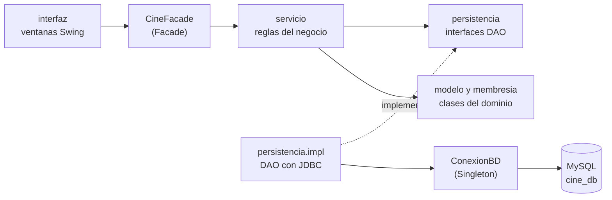
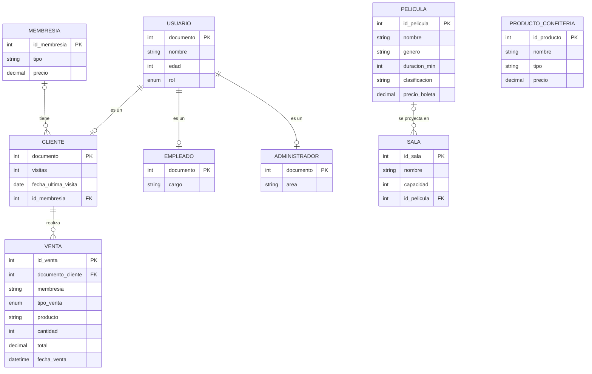
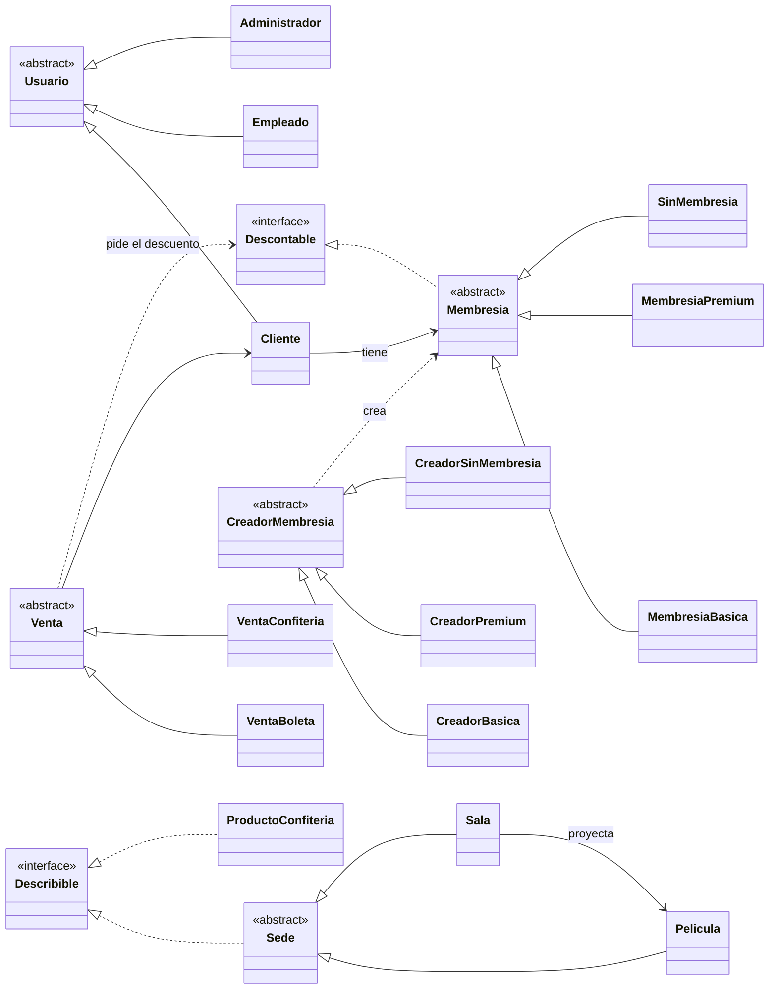
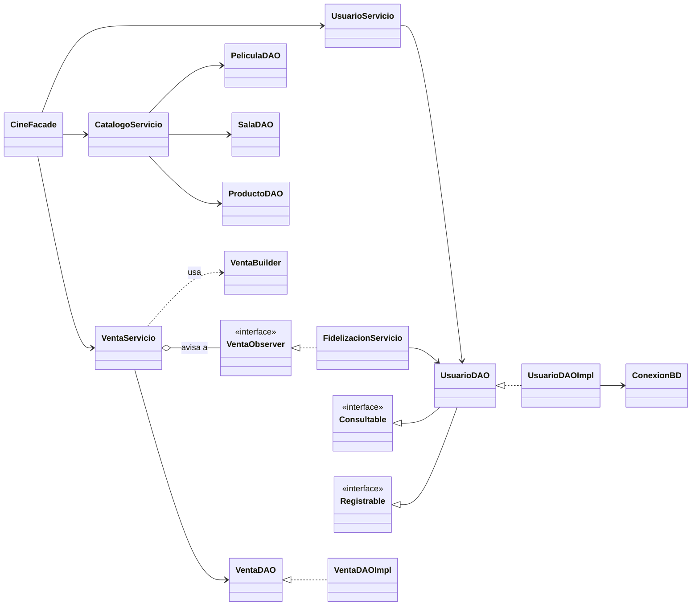
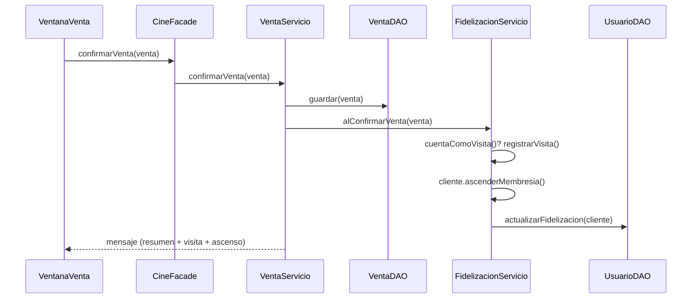

# Documentación del proyecto - Sistema de Ventas y Membresías para un Cine

Programación 1 - Universidad Libre. Integrantes: Juan David Aguilera y Marianna Fernandez.

## 1. Descripción

Aplicación de escritorio para un cine. Permite registrar clientes, películas y productos de confitería, vender boletas
(taquilla) y productos (confitería) y consultar lo registrado. Cada cliente puede tener una **membresía** que le da descuentos:

- **Básica** (se compra): 10 % en boletas y 5 % en confitería.
- **Premium** (se gana con 30 visitas en días distintos siendo Básica): 25 % en boletas y 15 % en confitería.

Todo se guarda en una base de datos **MySQL** (XAMPP), así que la información sigue ahí al cerrar el programa.

## 2. Arquitectura

La aplicación se divide en capas. Cada capa solo habla con la de abajo y casi siempre a través de una interfaz.

| Paquete | Responsabilidad |
|---|---|
| `interfaz` | Pide datos al usuario y muestra resultados. No tiene reglas de negocio. |
| `servicio` | Reglas del negocio: registrar, vender, fidelizar. Incluye la fachada. |
| `modelo`, `membresia` | Las clases del dominio: usuarios, sede, ventas y membresías. |
| `persistencia`, `persistencia.impl` | Guardar y leer de MySQL con DAO y JDBC. |
| `excepciones` | Excepciones propias del dominio. |

## 3. Modelo de datos

Script: `database/cine_db.sql` (base de datos `cine_db`, motor InnoDB, `utf8mb4`).

Decisiones de diseño:

- **Herencia de `Usuario` en tablas:** una tabla padre (`usuario`) y una tabla por cada hija (`cliente`, `empleado`,
  `administrador`), igual que en las clases Java. La columna `rol` indica de qué hija es cada fila.
- **Membresía del cliente:** `cliente.id_membresia` apunta a la tabla `membresia`; vacío (`NULL`) significa que no tiene membresía.
  Los porcentajes de descuento no están en la base de datos: los calcula cada clase de membresía.
- **Sala y película:** `sala.id_pelicula` es la película que se proyecta (puede ser `NULL`). Si se borra la película, la sala queda sin película.
- **Ventas como historial:** `venta` guarda el nombre del producto, el precio y la membresía del momento. Así el historial no
  cambia si luego se modifica un precio o la membresía del cliente.
- **Restricciones:** llaves primarias y foráneas, `UNIQUE` en el nombre de sala y tipo de membresía, y `CHECK` para valores
  válidos (precios ≥ 0, cantidad > 0, edad entre 0 y 120...). La aplicación valida antes de guardar; la base de datos es la segunda barrera.

## 4. Diseño de clases

Servicios y acceso a datos:

## 5. Qué pasa al confirmar una venta

## 6. Principios SOLID

| Principio | Cómo se aplica | Dónde verlo |
|---|---|---|
| **S** | Cada clase tiene una sola tarea. Antes, una clase (`Registros`) guardaba las listas, validaba, calculaba y vendía; ahora cada servicio tiene su tarea y cada DAO su tabla. | `servicio.*`, `persistencia.impl.*` |
| **O** | Para agregar algo nuevo se agrega una clase, no se modifica la existente. El descuento depende de la hija de `Venta` y de la membresía, no de un `if` sobre textos. | `Venta`, `Membresia`, `VentaObserver` |
| **L** | Cualquier `Membresia` (básica, premium o `SinMembresia`) se puede usar donde se espera una `Membresia`. `Cliente.ascenderMembresia()` le pregunta a la membresía en vez de comparar su tipo. | `Cliente`, `Membresia.ascender` |
| **I** | Interfaces pequeñas en vez de una grande: `Consultable` (leer) y `Registrable` (guardar) se combinan solo donde hacen falta. | `persistencia.*` |
| **D** | Los servicios reciben interfaces DAO por el constructor; solo `SistemaCine` conoce las clases concretas. | `servicio.*`, `SistemaCine` |

## 7. Patrones de diseño

| Patrón | Problema que resuelve | Clases |
|---|---|---|
| **Singleton** (creacional) | Todos los DAO deben compartir una sola conexión a MySQL, no abrir una por consulta. | `ConexionBD` |
| **Factory Method** (creacional) | Convertir el texto guardado en la base de datos (`BASICA`, `PREMIUM`...) en el objeto de membresía correcto sin `new` repartidos por el código. | `CreadorMembresia` y sus tres hijas |
| **Builder** (creacional) | Armar una venta tiene varios pasos y validaciones (cliente, boleta o producto, cantidad, total). | `VentaBuilder` |
| **Facade** (estructural) | Las ventanas no deben conocer tres servicios ni la base de datos. | `CineFacade` |
| **Adapter** (estructural) | La `JTable` solo entiende `TableModel` y el programa maneja listas de objetos. | `TablaAdapter`, `Tablas` |
| **Strategy** (comportamiento) | El descuento cambia según la membresía; se cambia de estrategia sin `if`. | `Descontable`, `Membresia` y sus hijas, `Venta.descuentoSegun` |
| **Observer** (comportamiento) | Al vender hay que contar la visita y ascender, pero `VentaServicio` no debe saber de fidelización. | `VentaObserver`, `FidelizacionServicio`, `VentaServicio` |
| Null Object (extra) | Evitar revisar `null` cuando el cliente no tiene membresía. | `SinMembresia` |

## 8. Cómo extender el sistema

- **Nueva membresía (por ejemplo, VIP):** crear `MembresiaVip extends Membresia` con sus descuentos, crear `CreadorVip extends
  CreadorMembresia`, agregar su `case` en `CreadorMembresia.para(...)` e insertar su fila en la tabla `membresia`.
  `Cliente`, `Venta` y las ventanas no se modifican.
- **Nuevo tipo de venta (por ejemplo, alquiler de sala):** crear una hija de `Venta` que implemente `getTipoVenta()`, `descuentoSegun()`
  y `cuentaComoVisita()`, y agregarla al `enum` de `venta.tipo_venta`.
- **Nueva reacción al vender (por ejemplo, enviar un correo):** crear una clase que implemente `VentaObserver` y registrarla en
  `SistemaCine` con `agregarObservador(...)`.

## 9. Limitaciones conocidas

- **Sin control de aforo:** la capacidad de la sala es informativa; no se descuentan puestos al vender.
- **Comprar la membresía básica no genera una venta:** solo asigna la membresía; el precio de $20.000 no queda en el historial.
- **Sin edición ni borrado** desde la aplicación de clientes, películas, productos ni ventas.
- **Salas fijas:** hay 3 salas (vienen del script SQL); desde la aplicación solo se les cambia la película.
- **Una sola conexión compartida:** suficiente para una aplicación de escritorio de un usuario; un sistema con muchos usuarios
  simultáneos usaría un pool de conexiones.
- **Sin pruebas automatizadas:** la verificación se hace ejecutando la aplicación (ver "Flujo de prueba recomendado" en el README).
